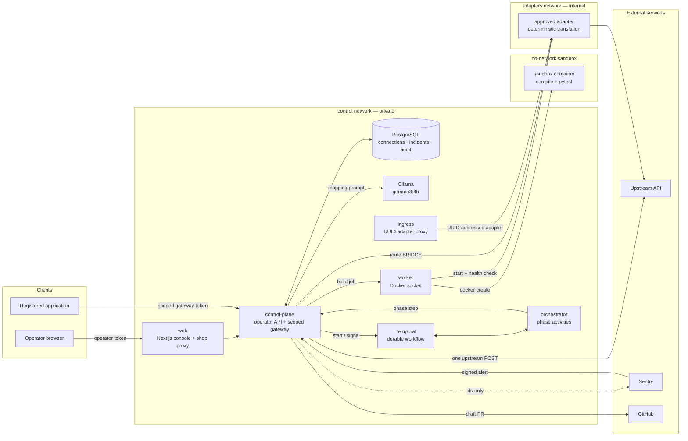

# ContractBridge

**Recover now. Fix permanently. Remove the workaround when production is healthy.**

ContractBridge is a plug-in control plane for API contract drift. A registered
application sends an API call through its scoped gateway. When the upstream
response no longer matches the contract that application expects, ContractBridge
records an incident and asks a local open-weight Gemma model for a constrained,
declarative mapping.

One verified mapping drives two repairs:

1. **Temporary runtime repair:** a deterministic compatibility proxy can restore
   traffic only after an operator approves the verified candidate, isolated tests
   pass, and the built artifact matches those approved inputs.
2. **Permanent code repair:** the same mapping produces a reviewable client patch
   and, when configured, a real GitHub draft pull request.

The temporary rule remains active after merge. It is retired only after the
registered deployment reports the matching commit and authorized synthetic probes
show that the deployed client works with translation bypassed.

The core has no shopping, payment-provider, repository, or field-name assumptions.
The synthetic shop is an optional example stack under `examples/`.

## How it works



The model never sits on the live request path. Only the worker holds the Docker
socket; adapters and the verification sandbox run in separate isolation domains.
See the [low-level design](docs/low-level-design.md) for sequences and state machines.

## Safety model

- Gemma proposes JSON data; generated model code is never executed.
- Trusted templates and a fixed interpreter implement supported mappings.
- A failed POST is sent upstream exactly once and is never replayed automatically.
- Runtime activation needs an operator approval for the exact verified candidate,
  passing isolated tests, and a build from those approved inputs. The control plane
  never activates a bridge without an explicit approve request for the current
  candidate.
- A rejection records the operator's review comment and feeds it back into the
  next Gemma proposal; the model still cannot invent fields outside the schema.
- GitHub publication creates a draft PR. ContractBridge does not merge or deploy it.
- Merge alone never removes the temporary bridge.
- Request and response bodies, credentials, prompts, and model output are excluded
  from Sentry and workflow history.

## Stack

Python 3.14, Starlette, PostgreSQL, Temporal's Python SDK, Ollama/Gemma,
Next.js/React, and Docker.

## Quick start: generic core

Requirements: Docker Engine/Desktop with Compose and Python 3.14. The default
`gemma3:4b` model benefits from several GB of free memory and storage.

```sh
./scripts/bootstrap.sh
```

Open <http://localhost:3000>. The generated operator token remains in the ignored
root `.env`. The generic core starts with no provider authorized and no integration
registered. Add allowed upstream origins to `UPSTREAM_ALLOWLIST`, then register an
integration through the operator API or a trusted `INTEGRATIONS_FILE`. The console
then presents the resulting operational state and lets the operator approve or
reject each verified candidate.

| Interface | Local address |
| --- | --- |
| Operator console | <http://localhost:3000> |
| Control-plane API | <http://localhost:8000/api/v1> |
| Adapter ingress | <http://localhost:18080> |

Published ports bind to loopback. The adapter, Ollama, database, and Temporal
ports stay internal.

## Optional synthetic shopping example

The example provides one switchable provider and one application with an unchanged
v1 client. It is not part of the core deployment and handles no payment or personal
data.

```sh
./scripts/bootstrap.sh --example shopping
```

1. Keep `examples/provider/provider.json` at `{"version":"v1"}` and make a
   successful synthetic order.
2. Change it to `{"version":"v2"}`. The same client request now fails, creating
   an actual contract-drift incident without replaying the POST.
3. Follow the incident in the operator console while ContractBridge fetches the
   provider's current OpenAPI document, invokes Gemma, and runs isolated tests.
4. Review the verified mapping. Approve it to build and activate the temporary
   bridge, or reject it with a comment; Gemma uses that comment for a new mapping.
5. If GitHub is configured for this integration, inspect the resulting draft PR.
   Otherwise, download the real patch artifact; no PR is claimed.

Stop the corresponding stack with:

```sh
./scripts/stop.sh --example shopping
```

The example is generic input, not a special-cased workflow: the same review,
comment, and activation path applies to any registered integration.

## Register an integration

Each integration declares:

- the client-expected OpenAPI contract;
- an operator-allowed upstream origin and current-spec path;
- an optional operation pair and independent synthetic or sanitized fixtures;
- an optional declarative Python client target for the permanent patch;
- an optional repository/base branch, monitored Sentry project, and deployed
  application verification endpoint.

Every candidate is reviewed in the console: approve it to build and activate the
temporary bridge, or reject it with a comment that Gemma applies to the next
mapping.

See [`examples/shopping/integration.json`](examples/shopping/integration.json) for
a complete, explicitly synthetic registration file and
[`docs/low-level-design.md`](docs/low-level-design.md) for the API lifecycle.
Changing the application API base URL to the returned scoped gateway is required;
ContractBridge cannot intercept arbitrary outbound traffic by itself.

## Sentry and GitHub

Sentry has two separate roles:

- a monitored application project observes the integration failure and can send a
  signed event-alert webhook to `/api/v1/hooks/sentry`;
- ContractBridge's backend/web projects observe the repair agent itself.

For a fully local demonstration, `INCIDENT_TRIGGER=gateway` starts investigation
from the detected gateway failure while still reporting it to Sentry. A public
Sentry callback is not simulated. `INCIDENT_TRIGGER=sentry` waits for a correctly
signed, project-bound alert webhook.

GitHub webhooks at `/api/v1/hooks/github` are HMAC-verified and bound to registered
repositories, branches, commits, and environments. Configure credentials only in
the ignored `.env`; never commit them. See
[`docs/security.md`](docs/security.md) for webhook and telemetry boundaries.

## Durable orchestration

Temporal owns retries and the potentially long wait between investigation, PR
merge, deployment, and verification. The base Compose file intentionally runs
Temporal's persistent **development server** for a local demo. It is not a
production Temporal deployment. Use a supported external Temporal service or
production cluster for hosted environments.

## Development

```sh
uv sync --python 3.14
python3 scripts/install_oasdiff.py
PATH="$PWD/.local/bin:$PATH" .venv/bin/python -m pytest -q
.venv/bin/ruff check src tests ops scripts examples
npm --prefix apps/web ci --ignore-scripts
npm --prefix apps/web test
npm --prefix apps/web run typecheck
npm --prefix apps/web run build
```

The worker has Docker authority and is a trusted, host-sensitive component. The
control plane and generated adapters do not receive the Docker socket.

## Supported scope

The current engine handles one selected JSON POST operation within a bounded
OpenAPI 3.0/3.1 subset. Supported transformations include copies/renames,
nesting/flattening, arrays, reviewed constants, and reviewed enum mappings.
Authentication changes, missing business data, undeclared semantics, arbitrary
source-code rewriting, and unsupported schemas stop for human action.

Permanent repair currently supports a registered `python-declarative` client and
one verified migration cycle per registration. After deploying that repair,
update or re-register the new client contract before monitoring the provider's
next version. ContractBridge does not claim endless chained migrations.

Passing fixtures prove only the declared examples, not universal compatibility.
The optional provider and fixtures are synthetic and are never presented as live
Gemma, remote GitHub, or production evidence.

## Documentation

- [Low-level design and sequence diagrams](docs/low-level-design.md)
- [Security boundaries](docs/security.md)
- [Verification and evidence](docs/verification.md)
- [API reference (OpenAPI)](docs/control-plane.openapi.json)
- [Decision records](docs/decisions/)
- [Contributing](CONTRIBUTING.md)

## License

ContractBridge is [MIT licensed](LICENSE). Gemma is open-weight under
[Gemma's terms](https://ai.google.dev/gemma/terms); model weights are downloaded
separately. Other dependencies retain their respective licenses. AI assistance
was used during development.
