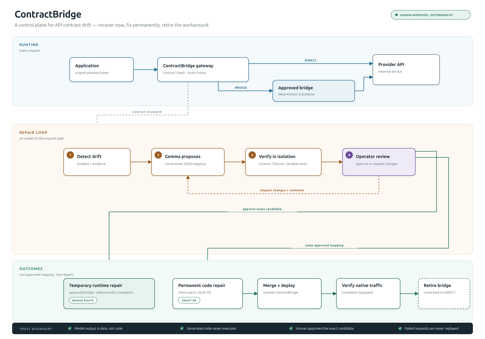

# ContractBridge architecture at a glance

**Blog attachment:** [PNG, 2×](assets/contractbridge-architecture.png) · [editable SVG](assets/contractbridge-architecture.svg)

*A control plane for API contract drift: recover now, fix permanently, retire the workaround.*

## The problem

APIs drift. A route is renamed, a field moves, an enum grows, or a response
shape changes. The client is still correct for the old contract, but production
starts failing. ContractBridge sits between the client and the upstream API,
detects the mismatch, and turns it into a bounded repair.

## What the diagram shows

- **Runtime.** Every request goes through a scoped gateway. The gateway forwards
  it **DIRECT** to the upstream API, or, after approval, routes it through the
  **BRIDGE** — a deterministic request and response translation.
- **Repair loop.** A contract failure creates an incident. A local Gemma model
  proposes a constrained JSON mapping. The candidate is checked against schemas,
  independent fixtures, and isolated tests. An operator approves the exact
  verified candidate or requests changes with a comment.
- **Outcomes.** The same approved mapping drives two repairs: a temporary
  runtime bridge and a permanent client patch / draft pull request. The bridge
  is retired only after the deployed client is verified with translation
  bypassed.
- **Trust boundary.** The model never sits on the request path. Its output is
  data, not code. Generated code is never executed. A failed business request is
  sent upstream once and is never automatically replayed.

Solid arrows are requests or artifacts. Dashed arrows are control signals,
evidence, or feedback.

## Why two repairs?

The temporary bridge restores traffic now. The permanent patch removes the need
for the bridge later. Keeping both tied to the same approved mapping stops the
runtime workaround and the code fix from drifting apart. Merge alone never
retires the bridge; the deployed client must prove it works with translation
bypassed.

## What is intentionally not in this picture

This is the conceptual system, not the deployment topology. The control plane,
PostgreSQL, Temporal, the Docker worker, the no-network verification sandbox,
and the internal adapter network are in the [detailed architecture](architecture.md).
The [low-level design](low-level-design.md) has the sequences and state machines.

## Spec-optional mode is a proposal

Today the target contract comes from the upstream OpenAPI document. A
spec-optional / observed-contract mode — inferring a partial contract from
sanitized successful samples, scoring coverage, and failing closed when evidence
is missing — is a proposal, not an implemented component. It would still require
operator approval and would not auto-activate a bridge.

## Blog caption

**Figure 1. ContractBridge architecture at a glance.** A scoped gateway detects
contract drift, a local Gemma model proposes a constrained mapping, and an
operator approves the exact verified candidate. The same mapping drives a
temporary runtime bridge and a permanent client patch; the bridge is retired
only after native traffic is verified.

Solid arrows are requests or artifacts; dashed arrows are control signals,
evidence, or feedback.
