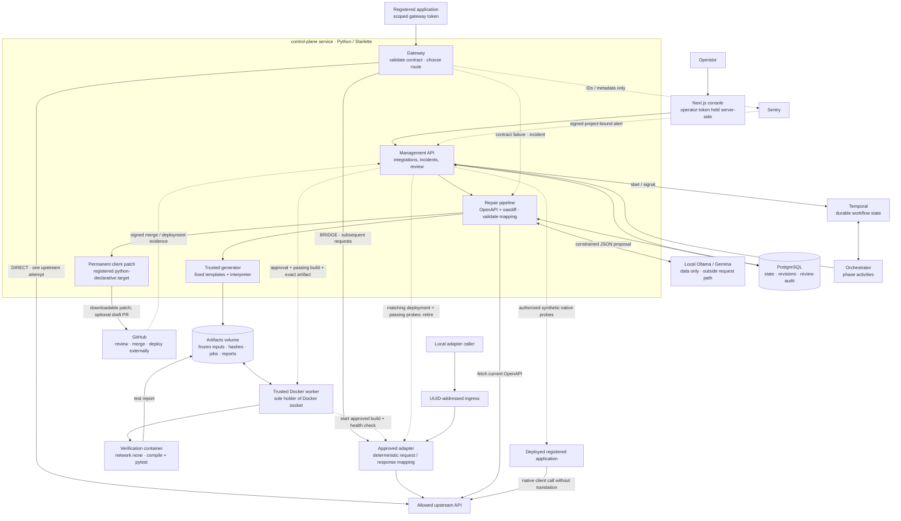
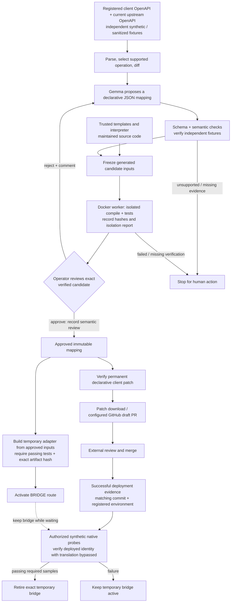

# ContractBridge architecture

> For the one-page, blog-friendly overview and hero diagram, see
> [architecture overview](architecture-overview.md). This page keeps the detailed
> deployment and trust-boundary view.

This is the current OpenAPI-based system, checked against the source and Compose
configuration. It follows the generic dual-repair and operator-review decisions
([006](decisions/006-generic-dual-repair.md),
[007](decisions/007-operator-review-loop.md)). The spec-optional / observed-contract
mode discussed in the saved session is a proposal, not an implemented component.
These diagrams describe architecture; they are not evidence of a live inference,
successful container build, or deployment.

## System overview

Solid arrows show calls or artifact flow; dotted arrows show background signals,
evidence, or control actions. The gateway and management API share the
`control-plane` service, but only background investigation invokes the model.

The failed business POST is never automatically replayed. Repair restores later
requests after approval. The adapter maps both requests and responses so the old
client can continue using its expected contract.

## One mapping, two repairs

The provider contract is checked again before approval, publication, and
activation. A stale candidate cannot proceed. Merge alone never retires a bridge;
ContractBridge does not merge or deploy the permanent patch.

## Deployment and trust boundaries

| Boundary | Components and constraints |
| --- | --- |
| Private `control` network | Web, control plane, PostgreSQL, Ollama, Temporal, orchestrator, worker, and ingress. |
| Internal `adapters` network | Dynamic adapters; control plane and ingress also join this network. The optional synthetic provider joins through the example overlay. |
| Verification container | Created by the worker with no network, read-only root, non-root user, resource limits, and no Docker socket. |
| Trusted host authority | Only the worker mounts the Docker socket; artifact jobs connect it to the control plane. |
| Loopback host ports | Console `3000`, API / gateway `8000`, UUID ingress `18080`. Database, model, Temporal, and adapter ports remain internal. |
| External integrations | Allowed upstream origins, optional Sentry, and optional GitHub; signed webhooks are bound to registered identities. |

Proposals, reference fixtures, trusted templates, and generated artifacts remain
separate evidence classes. A reference mapping is not live Gemma evidence, and a
test double is not a verified container build. Business payloads and secrets do
not belong in telemetry or demo evidence.

The synthetic shop is an optional application/provider example, not part of the
generic core. The local Temporal development server is for demos.

See [low-level design](low-level-design.md) for sequences and state machines,
[security](security.md) for authorization boundaries, and
[verification](verification.md) for evidence requirements. Implementation anchors:
[`monitoring.py`](../src/contractbridge/monitoring.py),
[`dual_repair.py`](../src/contractbridge/dual_repair.py),
[`generation.py`](../src/contractbridge/generation.py),
[`worker.py`](../ops/worker.py), and [`docker-compose.yml`](../docker-compose.yml).
