# ContractBridge — Low-Level Design

This document describes the implementation as it exists in the repository: module
boundaries, persisted state, request/response flows, and the gates that decide
whether a repair may touch traffic. Diagrams name real files and functions so
they can be checked against the code.

Scope note: the shopping provider and shop are an **example instance** of the
generic integration model. Nothing in the core assumes those names, fields, or
that a storefront exists.

---

## 1. Component map

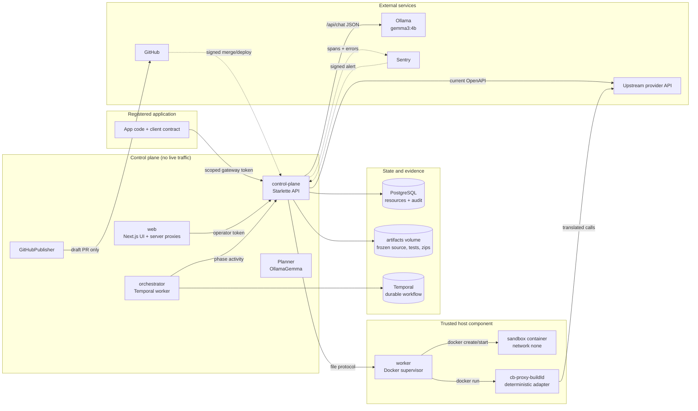

Two planes, deliberately separate:

| Plane | Path | Contains AI? |
| --- | --- | --- |
| Data plane | app → gateway → provider, or app → gateway → bridge → provider | No |
| Control plane | incident → investigation → candidate → PR / activation | Yes, only here |

The model never executes inside a request path, and generated source is never
executed as model output — it is rendered by trusted templates from validated
mapping data.

---

## 2. Deployment topology

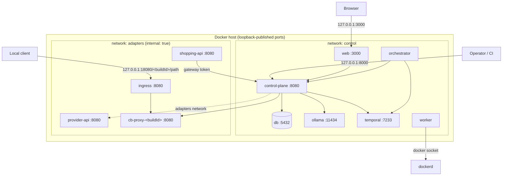

Ports and boundaries:

| Service | Published | Network(s) | Notes |
| --- | --- | --- | --- |
| `web` | `127.0.0.1:3000` | control | Holds `OPERATOR_TOKEN` server-side only |
| `control-plane` | `127.0.0.1:8000` | control, adapters | API + gateway; read-only root, all caps dropped |
| `ingress` | `127.0.0.1:18080` | control, adapters | Only ingress is publicly useful; adapters stay internal |
| `worker` | none | control | **Only** component with `/var/run/docker.sock` |
| `provider-api` (example) | `127.0.0.1:18081` | adapters | Switchable v1/v2 for demos |
| `shopping-api` (example) | none | control | Calls the gateway with a connection-scoped token |
| `db`, `ollama`, `temporal` | none | control | Not reachable from the host |

Restart-safe state lives in PostgreSQL and the `contractbridge_artifacts`
volume. Containers, Temporal workflows, and adapters are recreatable.

---

## 3. Source map

| Concept | Module |
| --- | --- |
| HTTP surface, auth guard, error mapping | `src/contractbridge/api.py` |
| Gateway, incidents, repair orchestration, routing | `src/contractbridge/monitoring.py` |
| Operator-facing runtime routes | `src/contractbridge/monitoring_api.py` |
| Dual lifecycle (mitigate / permanent / verify) | `src/contractbridge/dual_repair.py` |
| Durable workflow and phase activity | `src/contractbridge/orchestration.py` |
| Gemma prompt, grammar, provenance | `src/contractbridge/planner.py` |
| Candidate JSON schema from real fields | `src/contractbridge/candidates.py` |
| Trusted code generation and hashes | `src/contractbridge/generation.py` |
| File protocol to the Docker worker | `src/contractbridge/sandbox.py` |
| Container isolation and test parsing | `ops/worker.py` |
| Draft PR creation | `src/contractbridge/publishing.py` |
| Signed Sentry/GitHub webhooks | `src/contractbridge/hooks.py` |
| Revisioned aggregates + audit | `src/contractbridge/resources.py`, `storage.py` |
| Integration registration, tokens, client targets | `src/contractbridge/integrations.py` |
| Automatic-mitigation policy | `src/contractbridge/mitigation_policy.py` |
| Contract parsing / strict schema normalisation | `src/contractbridge/contracts.py` |
| Deterministic transformation interpreter | `src/contractbridge/engine.py` |
| Ingress for UUID-addressed adapters | `src/contractbridge/ingress.py` |
| Browser console and server proxies | `apps/web/app/repair-console.tsx`, `apps/web/app/api/**` |

---

## 4. Persistence model

Two families: **migrations** (the classic spec-to-spec workflow and its build
history) and **runtime resources** (connections, incidents, webhook receipts).
Every write is a revision-guarded document update plus an append-only event.

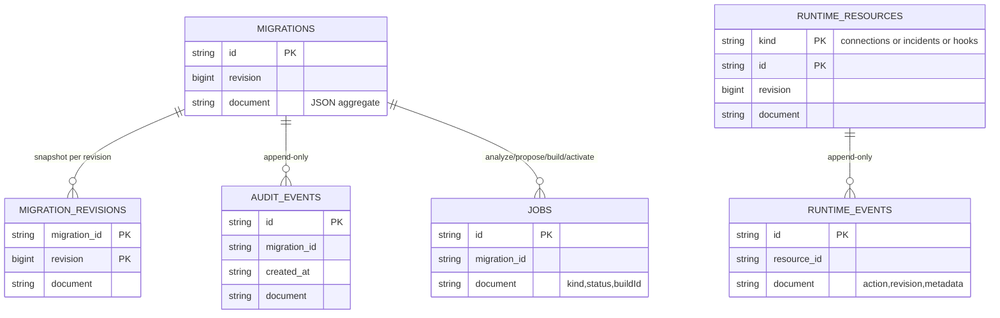

Rules enforced in `resources.py` / `storage.py`:

- `update(kind, id, action, visitor, expected_revision)` runs under a process lock
  plus `SELECT … FOR UPDATE` (PostgreSQL) and a conditional `UPDATE … WHERE
  revision = ?`; a lost race raises `Conflict` (HTTP 409).
- `If-Match`/`expected` revision prevents two operators or a retried activity from
  acting on stale state.
- `runtime_events` records the action, revision, and a small metadata subset
  (candidate artifact hash, publication authorization) — **never** request or
  response bodies.

Representative documents (abridged):

```jsonc
// connections
{
  "id": "…", "revision": 7,
  "name": "Shopping checkout",
  "upstreamBaseUrl": "http://provider-api:8080", "specPath": "/openapi.json",
  "sourceSpec": { /* parsed OpenAPI */ }, "sourcePath": "/v1/orders",
  "fixtures": [ /* synthetic request/response expectations */ ],
  "autoRepair": true, "dualRepair": true,
  "state": "MONITORING",                  // MONITORING | DEGRADED
  "route": { "mode": "DIRECT" },          // or BRIDGE + migrationId + buildId
  "generation": 0, "openIncidentId": null, "repairIncidentId": null,
  "baselineHash": "…", "autoPublishDraft": false,
  "client": { "kind": "python-declarative", "modulePath": "...", "bundlePath": "..." },
  "application": { "baseUrl": "...", "credentialEnv": "…", "environment": "staging" },
  "mitigationAuthorization": { "oldHash": "…", "newHash": "…", "fixturesHash": "…",
                               "behaviorHash": "…", "semanticReview": "…" }
}

// incidents
{
  "id": "…", "connectionId": "…", "kind": "HTTP_CONTRACT_MISMATCH",
  "state": "READY_FOR_REVIEW", "running": false,
  "occurrences": 1, "migrationId": "…",
  "candidate": { "artifactHash": "…", "inputHash": "…", "tests": 12,
                 "verificationMode": "isolated-docker", "semanticReview": "PENDING" },
  "lifecycle": {
    "phase": "GITHUB_NOT_CONFIGURED",
    "sharedMappingHash": "…",
    "mitigation": { "status": "REVIEW_REQUIRED" },
    "permanent":  { "status": "VERIFIED", "patchHash": "…", "applicationFiles": ["…"] }
  }
}
```

---

## 5. Trust boundaries and invariants

| Caller | Credential | May do |
| --- | --- | --- |
| Operator UI / CLI | `Authorization: Bearer <OPERATOR_TOKEN>` | Everything in `/api/v1/**` except gateway/native data calls |
| Registered application | `Bearer cbg.<connectionUUID>.<hmac>` | Exactly one connection's gateway operation, POST only |
| Sentry | `Sentry-Hook-Signature` HMAC + timestamp | Create/link an incident for a **registered** project and connection |
| GitHub | `X-Hub-Signature-256` HMAC | Record merge/deployment evidence for a **registered** repository |
| Generated adapter | none (network position) | Interpret one frozen mapping artifact; cannot reach the API or Docker socket |

The guard in `api.py` treats only `/health`, `/openapi.json`, the two hook paths,
and valid `cbg.` tokens as unauthenticated-with-scope; everything else needs the
operator token.

Invariants the code enforces:

1. **One upstream attempt per client request.** `_gateway` calls `exchange` once
   and reports `requestRetried: false`; background repair never re-POSTs the
   business operation.
2. **No payload retention.** Incidents store status codes, hashes, and metadata;
   Sentry events carry only connection/incident IDs and hashed contexts.
3. **The model proposes data only.** `OllamaPlanner` sends a JSON grammar built
   from real schema paths; `assemble` + `inspect_plan` validate the result; a
   blocker stops the flow even if a human approves.
4. **Activation names an exact artifact.** `workflow.submit("activate")` requires
   `state == READY_FOR_APPROVAL`, `confirmed is True`, and the SHA-256 of the
   on-disk `adapter.zip` to equal the approved hash.
5. **Automatic mitigation needs a pinned policy.** The policy hashes must match
   the exact old spec, new spec, fixtures, and normalised plan behaviour.
6. **A merged PR is not a deployment.** Retirement needs a successful deployment
   for the same commit and environment, then native bypass probes.
7. **Generated code never runs on the host.** Builds execute in a container with
   `--network none`, read-only root, `10001:10001`, 512 MB, 2 CPUs, pids 64, no
   Docker socket; the supervisor asserts those values from `docker inspect`
   before accepting a report.

---

## 6. Flows

### 6.1 Registration and baseline

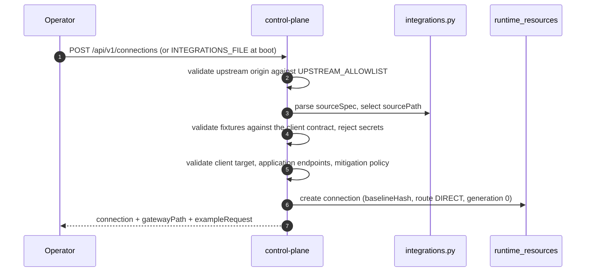

The gateway path is derived, not chosen by the caller:
`/api/v1/gateway/<connectionId><sourcePath>`. The client credential is
`gateway_token(GATEWAY_SIGNING_SECRET, connectionId)`.

### 6.2 Healthy monitored call

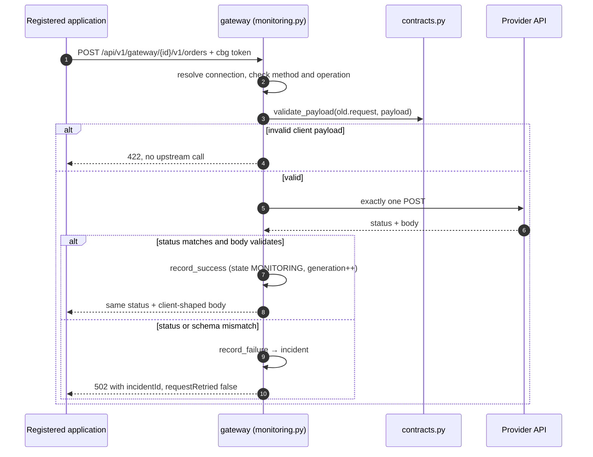

### 6.3 Drift detection and incident de-duplication

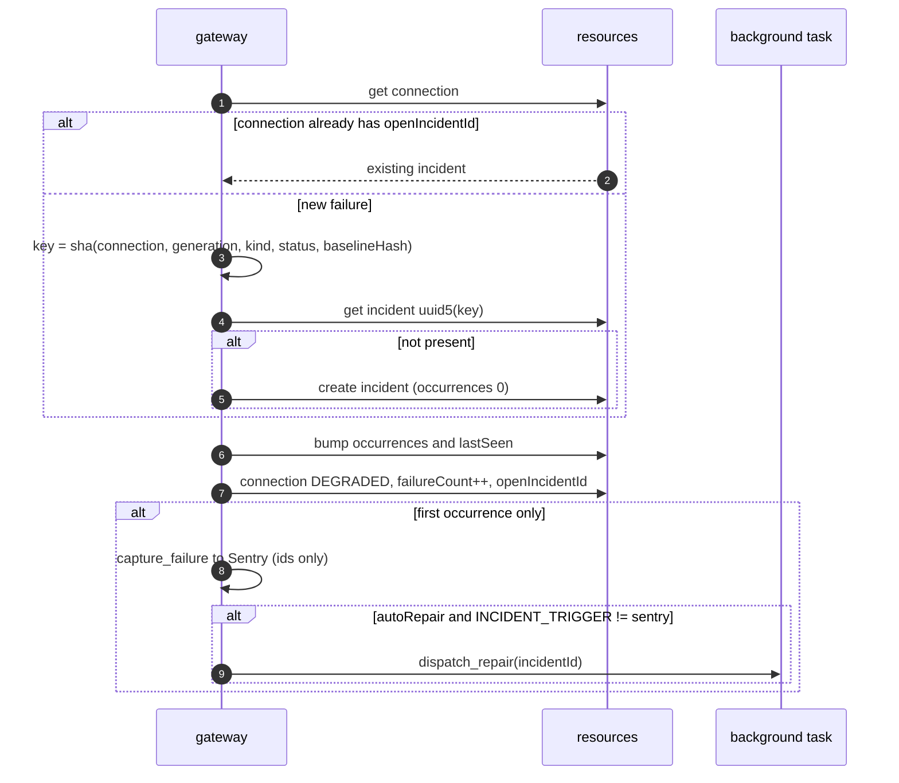

Why the deterministic ID matters: repeated failing traffic cannot spawn repeated
model runs, and a retry of the same failure collapses onto the same incident. The
connection `generation` changes only when a success resolves the incident or a
route is promoted, so the next unrelated drift gets a fresh incident.

### 6.4 Investigation → verified candidate

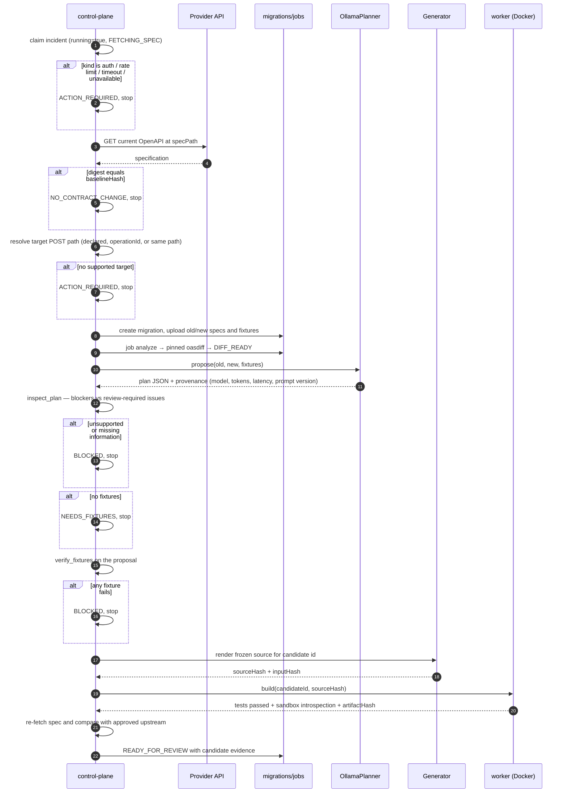

`assert_current` runs again before approval, publication, and activation: if the
provider changed while the agent was thinking, the repair is refused rather than
silently applied to a different contract.

### 6.5 Sandbox verification (worker side)

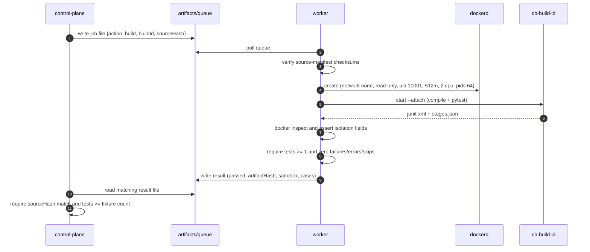

A timeout or missing result fails the repair; the API never treats an unverified
build as a pass.

### 6.6 Runtime mitigation gate

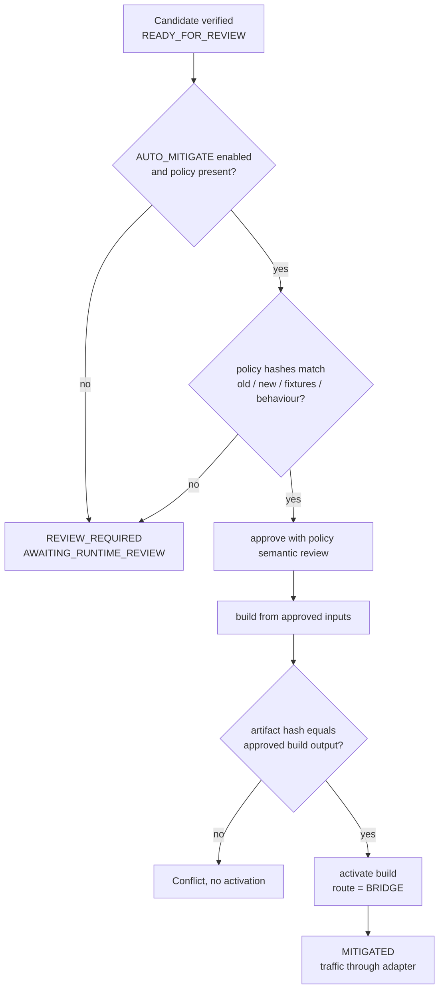

The policy is intentionally narrow. In the bundled example, a Gemma mapping whose
normalised behaviour differs from the reviewed reference produces
`REVIEW_REQUIRED` — that is the gate working, not a failure. Once a human or a
matching policy authorises it:

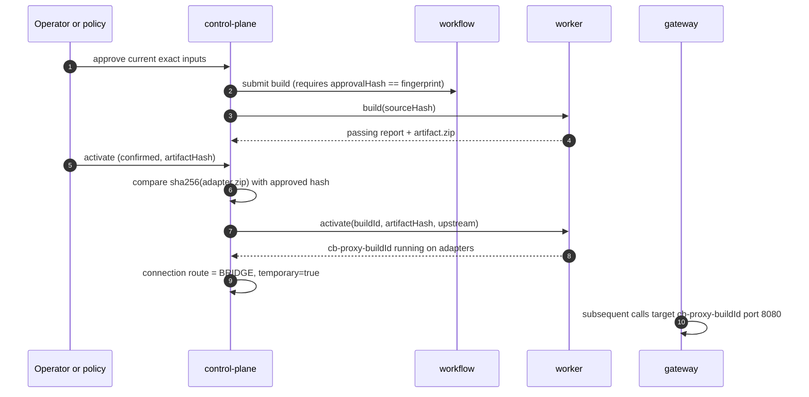

### 6.7 Permanent application repair (draft PR)

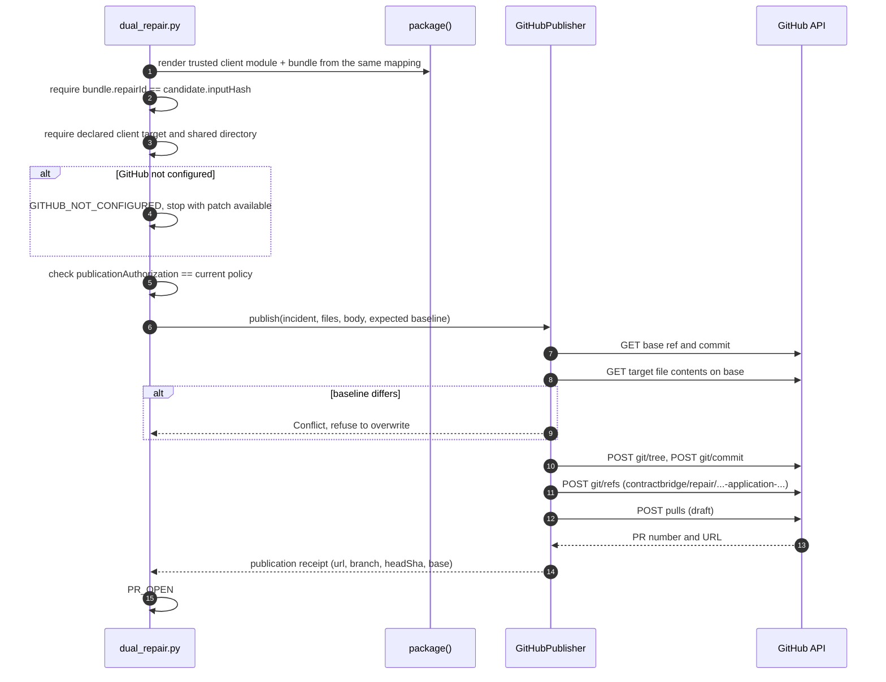

The PR body carries the mapping table, verification evidence, and the business
assumptions that still need review. ContractBridge never merges and never
deploys.

### 6.8 Sentry-triggered investigation

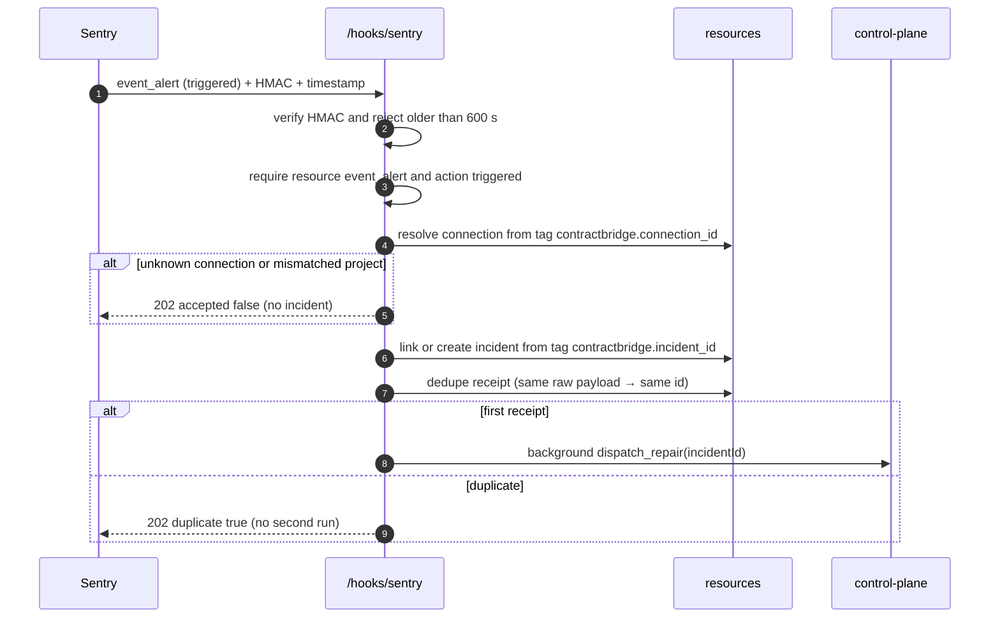

Two Sentry roles stay separate: the monitored-application project supplies the
failure signal; the ContractBridge projects trace the agent itself.

### 6.9 Merge, deployment, bypass probes, retirement

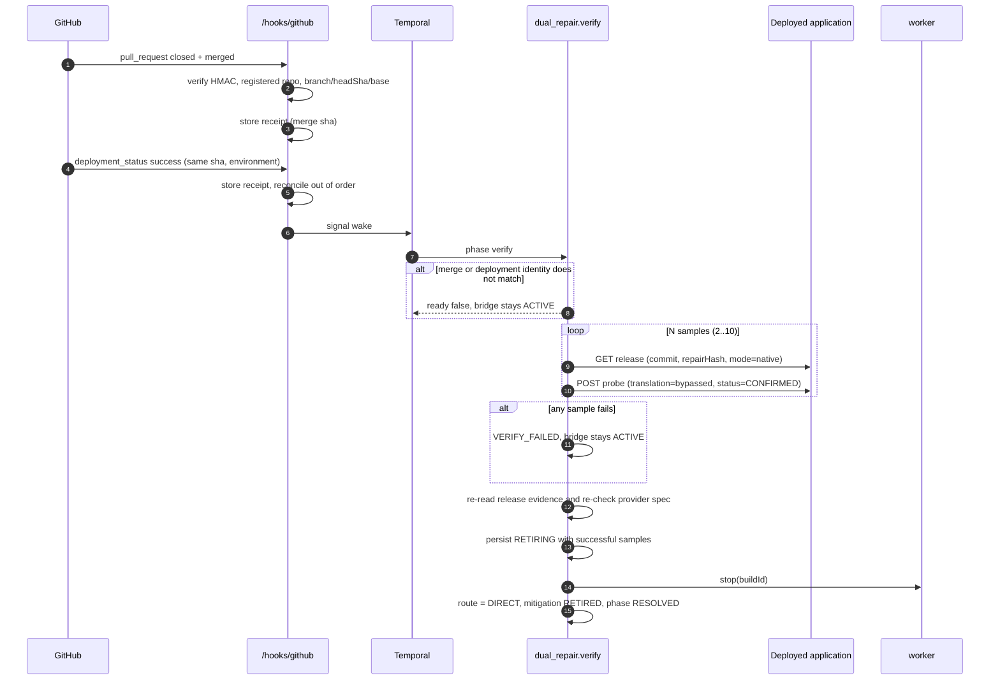

The `RETIRING` checkpoint exists so a crash between "samples passed" and "adapter
stopped" resumes retirement instead of re-running the synthetic operation.

---

## 7. State machines

### 7.1 Incident repair state

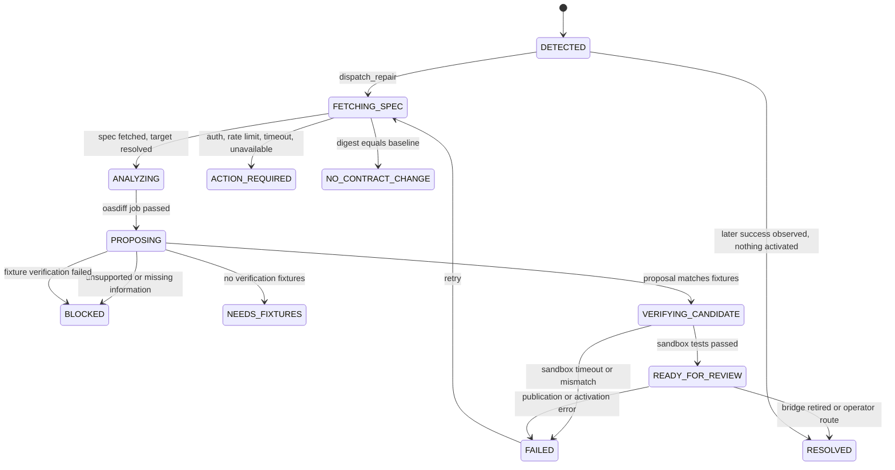

### 7.2 Dual lifecycle phase

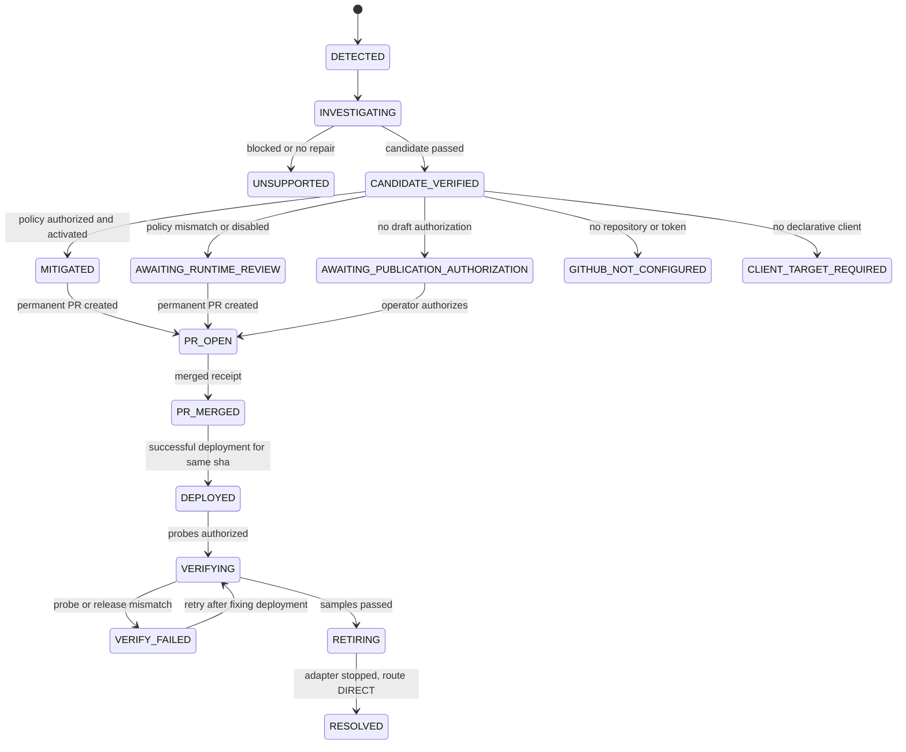

### 7.3 Connection routing

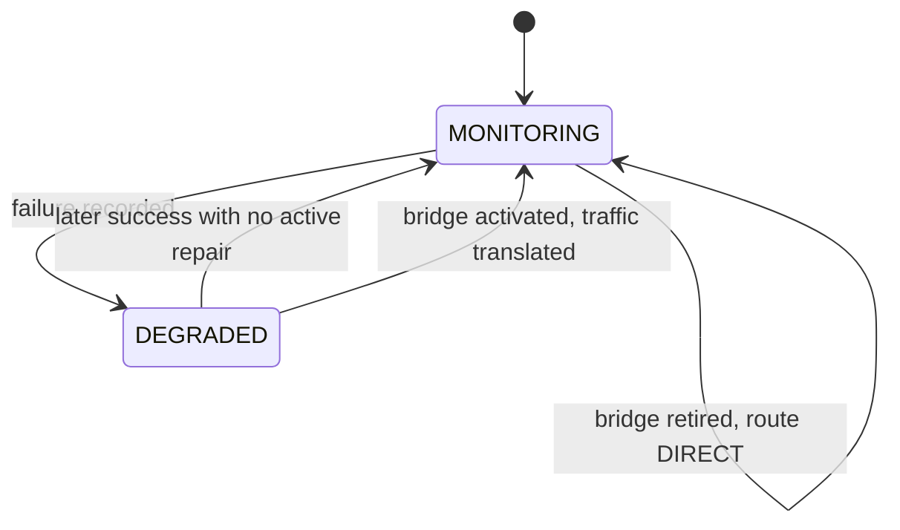

`route.mode` is the traffic switch; `state` is health. They move independently, so
a healthy connection can still be routed through a temporary bridge.

### 7.4 Migration and jobs

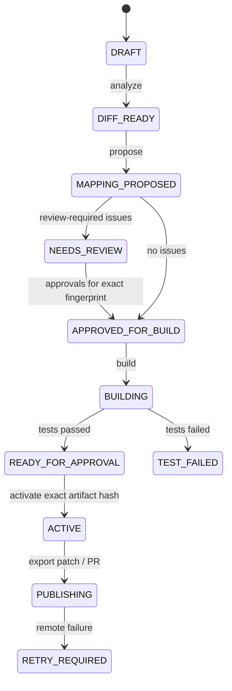

Jobs are `QUEUED → RUNNING → PASSED | FAILED`, persisted so an API restart does
not lose the record of what ran.

---

## 8. HTTP surface

Operator routes (bearer `OPERATOR_TOKEN`):

| Method | Path | Purpose |
| --- | --- | --- |
| GET/POST | `/api/v1/connections` | list / register integrations |
| GET | `/api/v1/connections/{id}` | connection + example request + gateway path |
| POST | `/api/v1/connections/{id}/access` | re-issue scoped gateway credential |
| PUT | `/api/v1/connections/{id}/fixtures` | replace verification fixtures |
| PUT | `/api/v1/connections/{id}/target` | bind provider target path |
| PUT | `/api/v1/connections/{id}/draft-automation` | authorize automatic draft PRs |
| POST | `/api/v1/connections/{id}/route` | select an active bridge |
| POST | `/api/v1/connections/{id}/direct` | return routing to direct |
| GET | `/api/v1/connections/{id}/audit` | append-only action history |
| GET | `/api/v1/incidents` | list incidents |
| GET | `/api/v1/incidents/{id}` | incident + candidate + mapping + evidence |
| POST | `/api/v1/incidents/{id}/retry` | retry investigation |
| GET | `/api/v1/incidents/{id}/patch` | download the real code patch |
| GET | `/api/v1/incidents/{id}/pr-preview` | preview PR files (no remote write) |
| POST | `/api/v1/incidents/{id}/publish` | publish draft PR when authorized |
| GET | `/api/v1/migrations/{id}` and sub-routes | spec-to-spec workflow, builds, replay, export |

Application data routes (scoped `cbg.` token, POST only):

| Path | Purpose |
| --- | --- |
| `/api/v1/gateway/{connectionId}{sourcePath}` | monitored call, translated when a bridge is active |
| `/api/v1/native/{connectionId}{targetPath}` | permanent-client path, requires `X-ContractBridge-Client-Revision` |

Webhook routes (HMAC only): `/api/v1/hooks/sentry`, `/api/v1/hooks/github`.
Ingress (no operator credential): `/{buildId}/{path}` on port 18080.
Web server proxies: `/api/bridge/**` (session cookie), `/api/shop/**` (shop token).

---

## 9. Configuration that changes behaviour

| Variable | Effect |
| --- | --- |
| `OPERATOR_TOKEN` | Operator bearer; also signs the web session cookie (min 24 chars) |
| `GATEWAY_SIGNING_SECRET` | Derives `cbg.` connection tokens; rotation invalidates all |
| `UPSTREAM_ALLOWLIST` | Origins an integration may register |
| `INTEGRATIONS_FILE`, `INTEGRATIONS_ROOT` | Boot-time registrations, confined to root |
| `OLLAMA_URL`, `OLLAMA_MODEL` | Inference endpoint and model identity |
| `DUAL_REPAIR` | Use the Temporal dual lifecycle instead of single repair |
| `AUTO_MITIGATE` | Permit policy-matched automatic runtime activation |
| `TEMPORAL_ADDRESS`, `TEMPORAL_NAMESPACE` | Durable workflow connection |
| `INCIDENT_TRIGGER` | `gateway` starts from observed failure; `sentry` waits for webhook |
| `SENTRY_WEBHOOK_SECRET`, `GITHUB_WEBHOOK_SECRET` | HMAC verification |
| `GITHUB_REPOSITORY`, `GITHUB_TOKEN`, `GITHUB_BASE_BRANCH` | Draft PR target |
| `DEPLOYMENT_ENVIRONMENT` | Environment a deployment receipt must match |
| `ALLOW_SYNTHETIC_PROBES`, `VERIFICATION_ORIGINS`, `VERIFICATION_CREDENTIALS` | Authorize bypass probes and which app/token may be called |
| `VERIFICATION_SAMPLES`, `VERIFICATION_INTERVAL` | Required healthy samples (2–10) and spacing |
| `ARTIFACT_ROOT`, `DATABASE_URL` | Storage locations |

Hard limits: Python 3.14 only (startup refuses otherwise), 1 MB upstream/ingress
bodies, 32 KB prompt context, 128 KB model response, 10 s upstream timeout, 180 s
model timeout, 300 s sandbox timeout, 12 min per workflow phase.

---

## 10. Failure semantics

| Failure | Result | Guarantee |
| --- | --- | --- |
| Invalid client payload | 422 before any upstream call | provider never sees it |
| Upstream 4xx/5xx or schema drift | 502 + `incidentId`, `requestRetried: false` | one attempt only |
| Timeout / connection error | 504 / 502, classified separately | not treated as contract drift |
| Same failure repeated | same incident, `occurrences` increments | no duplicate model work |
| Provider spec unchanged | `NO_CONTRACT_CHANGE` | no invented mapping |
| Unsupported mapping | `BLOCKED` | approval cannot override |
| Missing fixtures | `NEEDS_FIXTURES` | no untested candidate |
| Sandbox timeout | `FAILED`, retry available | no unverified artifact accepted |
| Provider changes mid-repair | `Conflict` before approval/publish/activate | mapping never applied to a different contract |
| Policy hash mismatch | `REVIEW_REQUIRED` | no automatic activation |
| GitHub baseline differs | `Conflict`, no branch written | no clobbering application code |
| Merge without deployment | bridge stays `ACTIVE` | merge alone retires nothing |
| Failed bypass probe | `VERIFY_FAILED`, bridge stays `ACTIVE` | no premature cleanup |
| Temporal unavailable | `WORKFLOW_UNAVAILABLE`, incident retained | retry does not lose the failure |

---

## 11. What each artifact proves

| Evidence | Proves | Does not prove |
| --- | --- | --- |
| Unit tests with mock transport | request construction and validation logic | a remote service was reached |
| Reference fixture plan | interpreter correctness | model quality |
| Gemma provenance (model, tokens, latency, context hash) | a real local inference produced that proposal | the mapping is semantically right |
| Isolated sandbox report with `docker inspect` fields | code compiled and tests passed under stated isolation | production compatibility |
| Draft PR URL | a remote branch and PR exist | the fix is deployed |
| Deployment receipt | a deployment event named that commit | the app works natively |
| Bypass probes | the deployed commit works without translation | future versions will |
